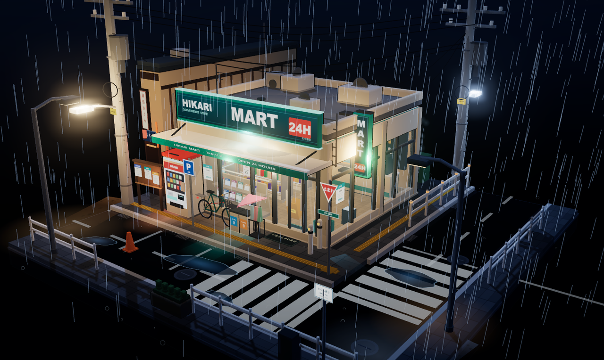
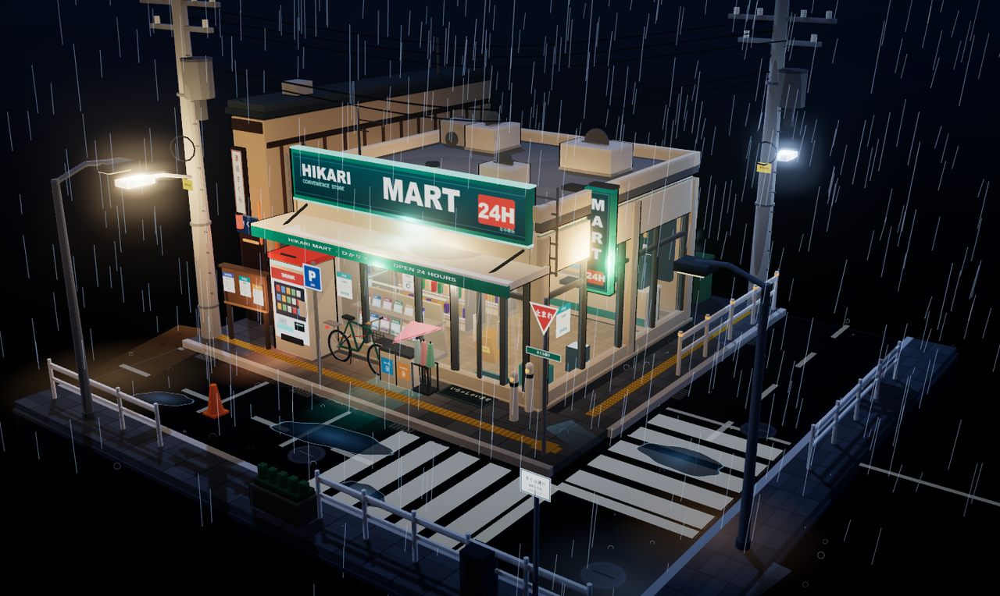
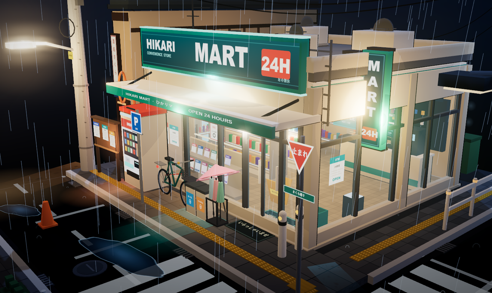
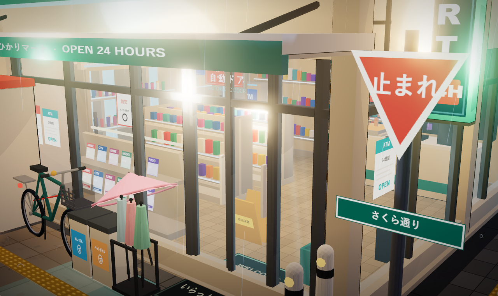
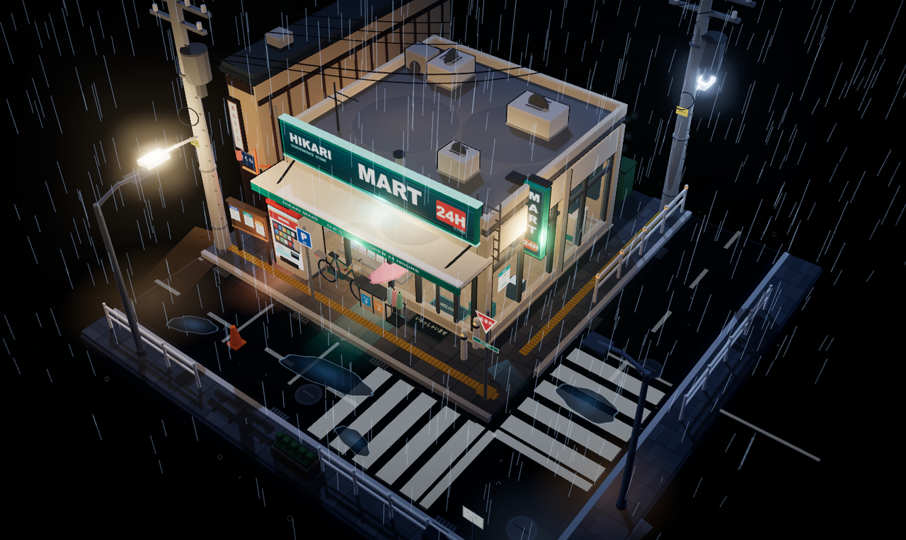
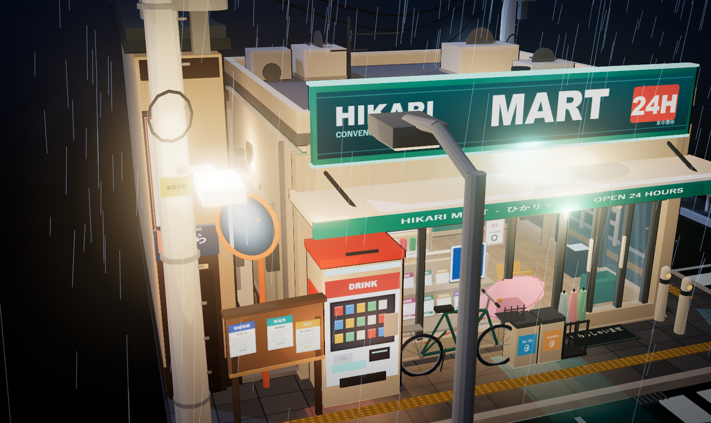
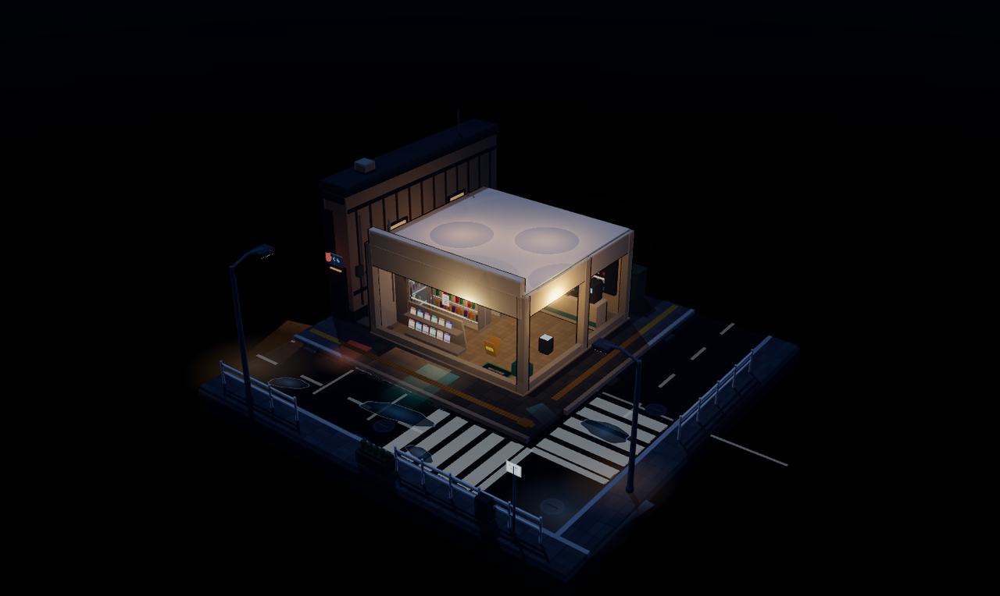
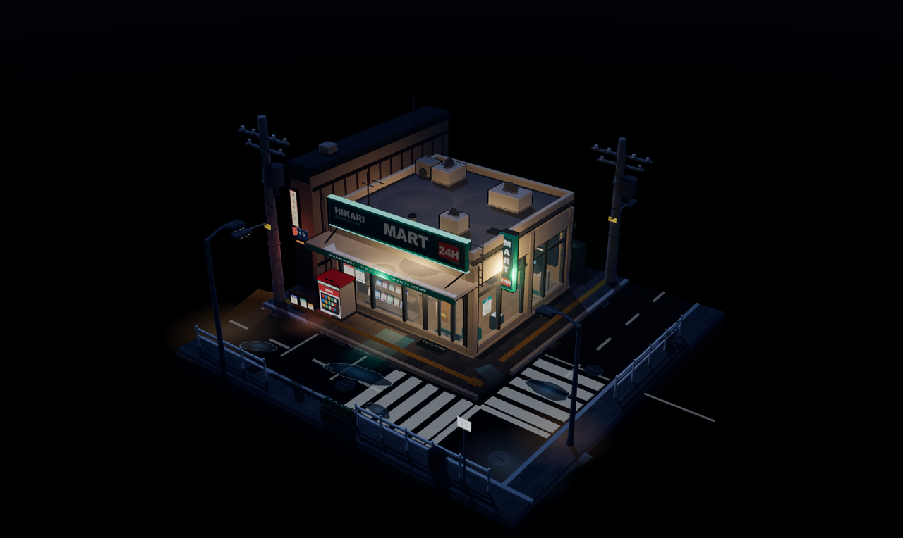
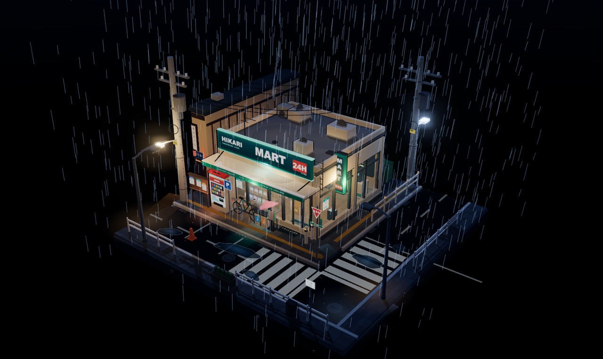

# 雨夜便利店 · 街角微缩模型

一个纯 Three.js 的实时三维小场景：方形底座上的日式便利店街角，雨夜霓虹，三渲二（Cel / Toon）画风。
没有人物、没有任何 UI 界面元素，整页只有一个可以自由拖拽旋转缩放的镜头。

> **本项目由一段自然语言提示词生成。** 完整提示词、需求逐条对照表、以及「哪些是代码生成、哪些是外部资源」的说明见 **[docs/PROMPT.md](docs/PROMPT.md)**。



## 运行

**桌面启动器（推荐）**：双击桌面上的「雨夜便利店街角」，或本目录里的 `启动.bat`。

启动器会静默拉起本地服务，等端口就绪后用 Chrome / Edge 的**应用窗口**打开模型——
没有地址栏、没有标签页、没有浏览器边框，就是一个干净的全屏展台。



**手动运行**：需要 Node.js 18+，在本目录执行 `npm start`，然后浏览器打开 <http://127.0.0.1:4321>。

**停止服务**：双击 `停止.bat`。也可以什么都不管——页面关闭约 2 分钟后服务会自动退出。

> 直接双击 `index.html` 不行：页面用 ES Module + importmap，必须经由 http 打开。
>
> 首次运行会创建一个独立的浏览器配置目录（`%LOCALAPPDATA%\RainyStoreCorner\app`），
> 所以不会污染你日常用的 Chrome 书签和登录状态。

## 操作

| 操作 | 效果 |
| --- | --- |
| 左键拖拽 | 绕模型旋转 |
| 滚轮 | 推近 / 拉远 |
| `R` | 重播入场动画 |

松手静置 7 秒后镜头会缓慢自转；任意交互立刻停止。

## 截图

| 店面近景 | 店内陈设 |
| --- | --- |
|  |  |

| 俯视全貌 | 小巷与左邻 |
| --- | --- |
|  |  |

**入场动画的三个阶段**：地基与街道 → 建筑与招牌 → 道具与雨

| 3.6s | 5.4s | 8.9s |
| --- | --- | --- |
|  |  |  |

## 画面构成

- **底座**：12.5 × 12.5 的完整正方形底座，带翻边与铭牌，整体呈可收藏的桌面模型感。
- **街道**：L 形路口从底座南侧与东侧切过，街角转折清晰。含人行道、盲道、路缘石、排水沟与雨水篦子、井盖、停车位、双段斑马线、停止线、中央虚线。
- **便利店（视觉中心）**：三面玻璃幕墙 + 自动门 + 门头雨棚 + 主招牌 HIKARI MART 24H + 转角竖向灯箱；屋顶有空调机组、排气管、检修梯；背面有后门与室外机；侧面挂空调外机与管线。
- **店内**（透过玻璃清楚可见）：冷柜墙（三层饮料、灯条、玻璃门）、两排中岛货架（九色商品、价签条）、杂志架、收银台与前方的热食柜 / 收银机 / 咖啡机 / 香烟架、ATM、购物篮、小心地滑牌、天花板灯盘、吊牌 ATM / おでん / COFFEE、后墙整排商品架。暖白灯光从店内溢出到人行道。
- **街角道具**：自动贩卖机、自行车、垃圾桶（かん・びん / ペットボトル）、雨伞架与撑开的伞、公告栏、P 停车牌、止まれ标志与さくら通り路牌、弯道镜、护栏、车止柱、雪糕筒、街灯、电线杆与电线、小巷入口（啤酒筐 / 纸箱 / 窄贩卖机 / 壁灯）、左邻小酒馆（暖帘、灯笼、竖向灯箱）。
- **雨夜氛围**：1250 条雨丝、地面涟漪着色器、水汽、地面积水与霓虹倒影、灯光光晕、Bloom 泛光。

## 入场动画

约 8.8 秒的自下而上组装：

1. 0.0s　方形底座从下方升到位
2. 0.6s　街道地面升起，1.25s 路面标线浮现
3. 1.9s　左邻建筑生长 → 2.2s 便利店地坪 / 墙体逐面升起 → 2.9s 冷柜、天花板、吊牌
4. 3.3s　ATM、杂货架、杂志架、收银台（生长式）
5. 4.0s　屋顶落下、4.25s 玻璃幕墙落下、4.7s 雨棚、5.1s 招牌、5.2s 竖灯箱
6. 5.5s～6.6s　电线杆升起、雨伞架 / 自行车 / 贩卖机 / 公告栏 / 路牌 / 护栏依次弹入
7. 2.9s 起店内灯先亮，5.7s 贩卖机，6.4s 招牌霓虹启辉（带闪烁），6.4s 电线拉出，7.35s 开始下雨

镜头同时从远景缓慢推进到最终机位。

## 技术说明

- Three.js r170，全部本地化在 `vendor/`，运行时不联网。
- 三渲二：`MeshToonMaterial` + 五阶 `gradientMap` 阶梯着色 + 反向外壳描边（自定义 Shader，恒定屏幕宽度）。
- 后期：`EffectComposer` → `UnrealBloomPass` → `OutputPass`，ACES 色调映射。
- 场景约 900 个 mesh；饮料、商品、香烟等重复件用 `InstancedMesh`。
- 无任何外部模型与贴图：几何体全部代码拼装，招牌 / 海报 / 商品 / 路牌文字全部由 Canvas 2D 运行时绘制。

```
index.html          页面与 importmap
server.mjs          零依赖本地服务器（健康检查 / 心跳 / 闲置退出）
launcher.vbs        桌面启动器：静默起服务 → 等就绪 → 开应用窗口
启动.bat             启动器入口（无控制台）
停止.bat             关闭后台服务
icon.ico / icon.png 启动器与桌面快捷方式图标
docs/PROMPT.md      生成本项目的原始提示词与逐条需求对照
docs/screenshots/   项目截图
vendor/             three.module.min.js + OrbitControls / 后期处理
src/main.js         渲染器、镜头、后期、主循环
src/core.js         调色板、贴图生成、三渲二材质、描边、几何工具
src/build.js        入场组装时间线
src/street.js       底座、道路、人行道、标线、积水与反光
src/store.js        便利店建筑外壳、玻璃、雨棚、招牌、屋顶
src/interior.js     店内陈设
src/alley.js        左邻小酒馆、小巷、后场
src/props.js        街角道具、电线杆与电线
src/lights.js       雨夜灯光与亮灯时序
src/effects.js      雨、涟漪、水汽、霓虹闪烁
```

## License

代码以 MIT 发布。Three.js 遵循其自身的 MIT 许可。
